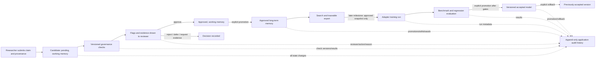

# Yukti Prototype Requirements and Boundaries

**Version:** 0.1 draft  
**Roadmap step:** 1 — requirements, use cases, and safety boundaries  
**Status:** Baseline established; pilot subject area remains open  
**Last updated:** 2026-10-07

## 1. Product goal

Yukti is a local-first research prototype that lets a researcher collect candidate knowledge, inspect its provenance and evidence, apply transparent governance checks, make an explicit human decision, and retain approved knowledge separately from unreviewed material. If later milestones justify it and the laptop can support it, a researcher may use approved examples for a reversible, benchmark-gated model adapter update.

Yukti is not an autonomous truth engine, policy authority, online continual-learning service, or production deployment platform. A flag means “review this”; it does not establish truth, safety, or importance. A model update is optional and cannot be a prerequisite for using the memory workflow.

## 2. Users and operating context

- **Primary user:** one researcher operating Yukti locally on Windows.
- **Reviewer:** initially the same researcher; the data model should allow named reviewers and a second-review requirement later.
- **Machine budget:** 16 GB system RAM, RTX 3050 with 4 GB VRAM, Ryzen 7 CPU.
- **Storage budget:** at most 20 GB for Yukti source, database, datasets, model weights, caches, adapters, checkpoints, logs, and reports combined. Track actual usage and leave headroom.
- **Connectivity:** local/offline operation by default. Any future download or remote service must be an explicit action with disclosed data and storage implications.
- **Initial interaction:** command-line interface and local SQLite database. A web dashboard is not part of the first prototype.
- **Initial content:** text claims and their evidence/provenance. Images, audio, video, and automatic web crawling are out of scope until separately specified.

## 3. Core user journeys

1. A researcher submits a claim with a source and evidence locator. Yukti saves it as pending and shows missing metadata or possible duplicate/contradiction flags.
2. The researcher inspects the candidate, evidence, rule results, and related items, then approves, rejects, defers, or requests more evidence with an actor and rationale.
3. An approved candidate can be promoted to long-term memory. Pending and rejected records are never returned as approved knowledge.
4. The researcher searches and exports approved memory while preserving source references and decision history.
5. In later milestones, the researcher exports a frozen set of approved examples, runs an explicitly invoked adapter-training/evaluation workflow, and promotes a model version only after it passes documented checks. A previous accepted version remains recoverable.

## 4. Functional requirements

Priority: **M0** is required for the governed memory prototype; **M1** is required before any model update; **M2** is a later enhancement.

| ID | Priority | Requirement | Acceptance condition |
|---|---|---|---|
| FR-01 | M0 | Capture a candidate’s text, source reference, submitter, timestamps, and available evidence locator. | A saved candidate can be inspected with its submitted provenance; absent fields are represented as missing, never fabricated. |
| FR-02 | M0 | Validate candidate fields and preserve the original submitted content or a content hash. | Invalid records produce a clear error and no partial database write; later edits do not erase the original/audit trail. |
| FR-03 | M0 | Keep candidate status and memory tier distinct. | New items are pending/working; status changes do not silently change memory tier. |
| FR-04 | M0 | Run transparent, versioned triage checks for configured governance concerns. | Each result names the check, outcome, explanation, and version; a check cannot approve a candidate. |
| FR-05 | M0 | Support human approve, reject, defer, and request-evidence decisions with reviewer and rationale. | Every decision records actor, time, action, and note; state transitions reject invalid actions. |
| FR-06 | M0 | Promote only approved items into long-term memory. | Attempting promotion of pending/rejected content fails and creates no long-term record. |
| FR-07 | M0 | Search and list approved memory with filters; keep pending/rejected content out of approved results. | Results reflect status, tier, and filters; each result retains provenance. |
| FR-08 | M0 | Record an append-only audit history of intake, checks, decisions, promotion, export, withdrawal, and errors relevant to state. | An item’s lifecycle can be reconstructed from history; ordinary commands cannot rewrite past events. |
| FR-09 | M0 | Back up and restore the database and its audit history. | A restored backup reproduces record IDs, statuses, provenance, and event history. |
| FR-10 | M0 | Withdraw or expire knowledge from active retrieval without silently erasing the decision history. | Withdrawn/expired content no longer appears in normal approved search; withdrawal is auditable. Legal or sensitive-data erasure requirements must be separately resolved before supporting such data. |
| FR-11 | M1 | Export a frozen, traceable training dataset containing only explicitly approved, in-scope records. | Every exported example maps to source records and approvals; rejected, pending, withdrawn, and out-of-scope items are excluded. |
| FR-12 | M1 | Train an adapter only through an explicit user-invoked run with a recorded configuration and resource estimate. | No intake/review command starts training; run metadata identifies base model, data snapshot, config, and outputs. |
| FR-13 | M1 | Evaluate candidate model versions against a fixed baseline and documented acceptance gates. | An incomplete or failed evaluation cannot mark a model active. |
| FR-14 | M1 | Keep immutable model manifests and support explicit promotion and rollback. | Version artifacts are hash-checked; a prior accepted version can be restored and the action is audited. |
| FR-15 | M2 | Add semantic retrieval or a graphical interface only where a measured use case and resource budget justify it. | A feature proposal includes evaluation benefit, privacy impact, storage/RAM/VRAM cost, and a reversible implementation plan. |

## 5. Non-functional requirements

| ID | Requirement | Acceptance condition |
|---|---|---|
| NFR-01 | Local-first privacy | No submitted content leaves the machine by default; any network operation is explicit, documented, and logged without exposing secrets. |
| NFR-02 | Storage ceiling | Yukti tracks project-owned data and artifacts; total planned/observed use never exceeds 20 GB. Model/cache/checkpoint paths are known before downloading or training. |
| NFR-03 | Hardware fit | Governance, memory, and evaluation tooling work on CPU. Any optional model run measures peak system RAM, VRAM, duration, and disk use on the target device before acceptance. |
| NFR-04 | Explainability | Governance results are inspectable and distinguish source facts, heuristic outputs, model outputs, and reviewer judgments. |
| NFR-05 | Reproducibility | Dependencies and model/data revisions are pinned; each evaluation and training run records configuration and input hashes. Nondeterminism is documented. |
| NFR-06 | Recoverability | Database backup/restore and model rollback instructions are verified before release. |
| NFR-07 | Robustness | Imported content is treated as data, not executable instructions; bad inputs fail safely; state changes are transactional. |
| NFR-08 | Maintainability | Core governance and database behavior stay modular, documented, and testable; optional model dependencies do not burden the baseline install. |
| NFR-09 | Honest claims | Prototype reports state dataset coverage, false-positive/false-negative findings, limitations, and checks not run; no unsupported factual-safety or forgetting-resistance claims. |

## 6. Governance and data boundaries

- Candidate, reviewer, source, evidence, decision, and model-run records are distinct entities with stable IDs and timestamps.
- Source trust is an attributed rationale or configured assessment, not an objective truth score. Record who assigned it and why when trust scoring is introduced.
- Evidence must be inspectable and tied to the claim. A URL alone does not prove the claim; inaccessible sources remain explicitly unverified.
- Possible-contradiction and duplicate checks are retrieval/review aids. Similar wording is not necessarily the same fact, and different wording may express the same fact.
- Human approval is required for long-term memory and for training eligibility. Any stricter policy can add additional review, never bypass it.
- Keep sensitive personal data, credentials, secrets, and copyrighted bulk corpora out of initial fixtures. Define handling, retention, and deletion policy before accepting such data.
- Treat imported text and model responses as untrusted content. Do not execute instructions found inside them or let them change policy/configuration.
- The audit log should be append-only through the application. This does not claim forensic tamper-proofing against a user with direct filesystem/database access.

## 7. Data flow and state model

## 8. Step 1 acceptance checklist

- [x] Product objective, user, local environment, storage and hardware constraints documented.
- [x] Core journeys and initial in/out-of-scope boundaries documented.
- [x] Functional and non-functional requirements have IDs and observable acceptance conditions.
- [x] Governance, privacy, and threat boundaries recorded.
- [x] Initial data flow and human-approval points documented.
- [ ] Pilot evaluation subject area selected.
- [ ] User confirms or revises the M0 baseline and open policy choices.

## 9. Open decisions and provisional defaults

| Decision | Provisional default | Status / consequence |
|---|---|---|
| First evaluation subject area | General factual knowledge, using small synthetic or licensed examples | Open to user input; required before Step 6 dataset construction. |
| Source trust scale | 0–1 with documented rationale and named assessor; no automatic authority implied | Provisional; define calibration before using as a gate. |
| Approval model | One named researcher for M0; support second-review policy in schema/design | Provisional; multi-user identity/access control is out of M0 scope. |
| Candidate scope | Text claims with evidence locators | M0; multimodal input is excluded. |
| Local model | No model selected or downloaded yet | Selection waits until the post-evaluation resource review in Step 7. |
| Database | SQLite local file | Current baseline; revisit only if measured concurrency/scale needs justify migration. |
| Network access | Off by default; explicit model/source downloads only | Any external service requires a privacy and storage decision first. |
| Sensitive data | Excluded from the initial prototype corpus | Revisit retention/erasure controls before accepting it. |

## 10. Change record

Record every change to this requirements baseline in `LOGBOOK.md`, including the requirement IDs affected and the reason. Preserve earlier decisions and supersede them with a new dated entry.
